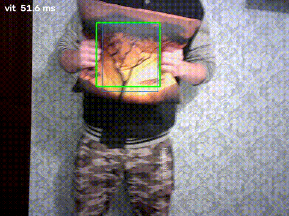
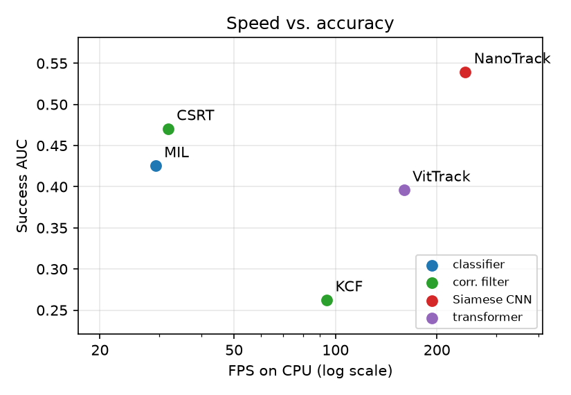

# Single-Object Tracking on CPU: Correlation Filters vs. Siamese CNN vs. Transformer



*VitTrack on clip C2 (fast motion), real time. Green = tracker, thin blue = ground truth, red = trajectory, top left = CPU time of the frame.*

Five trackers that ship with OpenCV (MIL, KCF, CSRT, NanoTrack, VitTrack) are benchmarked on a laptop CPU against hand-labelled ground truth, in eight conditions: baseline, fast motion, illumination change, low light, occlusion, scale change, rotation and a look-alike distractor. The repository contains everything needed to rerun the study: the code, the eight clips with their labels, and the raw results. **Main result:** the small Siamese CNN NanoTrack is both the fastest (4.1 ms/frame) and the most accurate on average, but each tracker family fails in a different condition (see [Findings](#findings)).

## Quick start

### 1. Install (about 2 minutes)

**Linux (Ubuntu 22.04/24.04) and macOS (Intel / Apple Silicon)**
```bash
git clone <this repo> && cd <repo>/code
python3 -m venv .venv && source .venv/bin/activate
pip install -r requirements.txt
```

**Windows 10/11 (PowerShell)**
```powershell
git clone <this repo>; cd <repo>\code
py -m venv .venv
.venv\Scripts\Activate.ps1      # if blocked: Set-ExecutionPolicy -Scope CurrentUser RemoteSigned
pip install -r requirements.txt
```

Requires Python >= 3.9 and OpenCV >= 4.10 (tested with 5.0). Don't install `opencv-python` and `opencv-contrib-python` in the same environment. The two deep trackers' models (~2.5 MB) download on first use into `models/`, pinned to fixed commits and SHA-256 verified.

### 2. Check that it works (about 1 minute)

Run all five trackers on the distractor clip, writing to a scratch CSV so the committed results stay untouched:
```bash
python tracking.py --compare --source clips/C8_distractor.mp4 --gt clips/C8_distractor_gt.txt --tag C8 --no-show --out results/check.csv
```
Each tracker prints one result row. The accuracy (`auc`) should match these values exactly, because the trackers are deterministic. Timings (`mean_ms`) depend on your CPU:

| Tracker | `auc` | `mean_ms` on the reference laptop |
|---|---|---|
| mil | 0.683 | 35 |
| kcf | 0.252 | 4 |
| csrt | 0.671 | 28 |
| nano | 0.440 | 4 |
| vit | 0.203 | 6 |

Drop `--no-show` to watch each tracker run. Green = tracker, blue = ground truth.

### 3. Reproduce every table (about 15-20 minutes, unattended)

```bash
mv results/trackers.csv results/trackers_published.csv     # keep the published numbers for comparison
for v in clips/C*.mp4; do gt="${v%.mp4}_gt.txt"; tag=$(basename "$v" | cut -d_ -f1)
  for opt in "" "--gray" "--skip 2" "--skip 4" "--recover orb"; do
    python tracking.py --compare --source "$v" --gt "$gt" --tag "$tag" --no-show $opt; done; done
python report.py      # -> results/tables.md (Tables 1-3) + code/docs/media/speed_accuracy.png (Figure 1)
```
Windows (PowerShell) version of the loop:
```powershell
foreach ($v in Get-ChildItem clips\C*.mp4) {
  $gt = $v.FullName -replace '\.mp4$', '_gt.txt'; $tag = $v.Name.Split('_')[0]
  foreach ($opt in '', '--gray', '--skip 2', '--skip 4', '--recover orb') {
    $a = $opt.Split(' ', [StringSplitOptions]::RemoveEmptyEntries)
    python tracking.py --compare --source $v.FullName --gt $gt --tag $tag --no-show @a } }
python report.py
```

**Expected:** every accuracy number in Tables 2-3 matches the published one. The timing columns will differ with your CPU.

- **Pedestrian sequence P1:** download MOT15 from [motchallenge.net](https://motchallenge.net/data/MOT15/); its label file `clips/P1_gt.txt` is already included. Then run:
  ```bash
  python tracking.py --compare --source "<path>/MOT15/train/TUD-Campus/img1/%06d.jpg" --gt clips/P1_gt.txt --tag P1 --no-show
  ```
- **Thread scaling (Table 4):** run with `--threads N`, written to a separate file:
  ```bash
  python tracking.py --compare --source clips/C1_baseline.mp4 --gt clips/C1_baseline_gt.txt --tag T1 --threads 1 --no-show --out results/threads.csv
  ```

### 4. Live demo with a webcam

```bash
python tracking.py --tracker nano      # drag a box around any object, ENTER; r = reselect, q = quit
```
Any tracker name works: `mil`, `kcf`, `csrt`, `nano`, `vit`. Add `--recover orb` to turn on re-detection after failure. If the camera won't open: on Linux, check `ls /dev/video*` and add yourself to the `video` group; on macOS, allow camera access for your terminal app (System Settings -> Privacy & Security -> Camera). On Windows the camera opens through DirectShow, which is much faster than the default backend.

### 5. Test on your own video

```bash
python tracking.py --record clips/my.mp4 --seconds 10                       # record (prints the real camera FPS)
python annotate.py --source clips/my.mp4 --out clips/my_gt.txt --every 2    # draw a box every 2nd frame; c = not visible
python annotate.py --source clips/my.mp4 --out clips/my_gt.txt --every 2 --redo          # revisit the 'not visible' frames
python annotate.py --source clips/my.mp4 --out clips/my_gt.txt --every 2 --frames 30,32  # fix specific frames
python tracking.py --compare --source clips/my.mp4 --gt clips/my_gt.txt --tag MY --save results/my.mp4
```
`--save` writes one annotated video per tracker (`results/my_<tracker>.mp4`). Other options: `--gray` (drop colour), `--skip N` (keep every Nth frame, i.e. a lower frame rate), `--init x,y,w,h` (start box without ground truth). A public LaSOT sequence ([huggingface.co/datasets/l-lt/LaSOT](https://huggingface.co/datasets/l-lt/LaSOT)) works the same way: `--source "airplane-1/img/%08d.jpg" --gt airplane-1/groundtruth.txt`.

### What's in the repository

| Path | Contents |
|---|---|
| `tracking.py` | The trackers, ORB re-detection, recording, the `--compare` benchmark and the metrics |
| `annotate.py` | Ground-truth labelling tool (keyframes + interpolation; MOT15 conversion) |
| `report.py` | Builds Tables 1-3 and Figure 1 from `results/trackers.csv` |
| `clips/` | The 8 recorded clips (C1-C8) and the label files, incl. P1's |
| `results/` | Raw results (`trackers.csv`, `threads.csv`) and the generated `tables.md` |
| `code/docs/media/` | Demo GIFs and Figure 1 |

---

# Results

## Setup

- **Trackers** (OpenCV 5.0, default parameters): MIL (online boosted classifier), KCF and CSRT (online correlation filters), NanoTrack (offline-trained Siamese CNN, 2 ONNX files, ~2 MB) and VitTrack (offline-trained transformer, ~0.7 MB). Optional ORB re-detection (`--recover orb`) re-initialises a tracker by feature matching when it reports a failure.
- **Hardware:** Intel Core i5-10300H laptop (4 cores / 8 threads, 2.5-4.5 GHz), 7.5 GB RAM, Ubuntu 24.04, Python 3.12, CPU only.
- **Data:** 8 own webcam clips (640x480, ~7 s, 70-75 frames; the camera delivered ~10 FPS indoors) and the MOT15 TUD-Campus pedestrian (P1). Boxes are hand-drawn on every 2nd frame (every frame in C3) with `annotate.py` and interpolated in between. Frames where the target is fully hidden or the room is dark are not scored.
- **Metrics** (OTB protocol): Success AUC (area under the success curve over IoU thresholds 0-1; main accuracy metric), Precision@20 (centre error <= 20 px), per-frame CPU time of `update()` (mean and 95th percentile). A frame where the tracker reports failure counts as IoU 0.

| ID | Condition | Scored / total frames |
|---|---|---|
| C1 | Baseline (normal light, moderate motion) | 72 / 72 |
| C2 | Fast motion / blur | 74 / 74 |
| C3 | Light switched off and on | 48 / 70 |
| C4 | Low light | 75 / 75 |
| C5 | Occlusion (behind a blanket) | 38 / 71 |
| C6 | Scale change (pillow fills the frame) | 71 / 71 |
| C7 | Rotation / flipping | 70 / 70 |
| C8 | Distractor (two identical flip-flops) | 70 / 70 |
| P1 | Pedestrian, MOT15 TUD-Campus | 24 / 71 |

## Speed and accuracy

**Table 1. Overall** (mean over the 9 sequences, all 8 threads).

| Tracker | mean ms | p95 ms | FPS | Success AUC | Prec@20 | Self-reported failures |
|---|---|---|---|---|---|---|
| MIL | 34.2 | 41.4 | 29 | 0.425 | 0.300 | 0 |
| KCF | 10.6 | 16.6 | 94 | 0.262 | 0.223 | 20 |
| CSRT | 31.4 | 39.2 | 32 | 0.470 | 0.337 | 7 |
| NanoTrack | **4.1** | **4.8** | **243** | **0.539** | **0.427** | 0 |
| VitTrack | 6.3 | 9.2 | 160 | 0.396 | 0.363 | 13 |



**Table 2. Success AUC per condition** (best in bold; within 0.015 = tie).

| Tracker | C1 | C2 | C3 | C4 | C5 | C6 | C7 | C8 | P1 |
|---|---|---|---|---|---|---|---|---|---|
| MIL | 0.422 | 0.222 | 0.390 | 0.295 | 0.376 | 0.353 | 0.468 | **0.683** | 0.619 |
| KCF | 0.392 | 0.112 | 0.557 | 0.265 | 0.337 | 0.109 | 0.115 | 0.252 | 0.222 |
| CSRT | 0.516 | 0.334 | 0.250 | 0.406 | 0.364 | 0.541 | 0.449 | **0.671** | 0.702 |
| NanoTrack | **0.600** | **0.428** | **0.664** | **0.548** | **0.405** | **0.552** | **0.498** | 0.440 | **0.720** |
| VitTrack | 0.300 | 0.353 | 0.582 | 0.023 | **0.408** | **0.558** | 0.402 | 0.203 | **0.735** |

**Table 3. Ablations** (Success AUC on C1-C8; delta vs. default).

| Tracker | default | grayscale | every 2nd frame | every 4th frame | + ORB re-detection | ORB recoveries | ORB cost |
|---|---|---|---|---|---|---|---|
| MIL | 0.401 | +0.006 | -0.039 | -0.070 | +0.000 | 0 | +2.0 ms |
| KCF | 0.267 | +0.000 | -0.090 | -0.124 | +0.047 | 6 | +7.9 ms |
| CSRT | 0.441 | -0.040 | -0.012 | -0.035 | +0.000 | 0 | +0.5 ms |
| NanoTrack | 0.517 | -0.070 | -0.006 | -0.026 | +0.000 | 0 | +0.1 ms |
| VitTrack | 0.354 | +0.007 | +0.015 | +0.032 | +0.000 | 0 | +0.4 ms |

**Table 4. Latency vs. CPU threads** (mean / p95 ms over C1, C6, C8; accuracy is identical for every thread count).

| Tracker | 1 thread | 2 threads | 4 threads | 8 threads |
|---|---|---|---|---|
| MIL | 43.1 / 56.3 | 37.8 / 44.5 | 37.4 / 43.4 | 39.3 / 48.8 |
| KCF | 11.4 / 19.5 | 10.7 / 16.4 | 10.6 / 16.0 | 11.8 / 19.8 |
| CSRT | 46.6 / 66.8 | 35.7 / 47.4 | 33.7 / 41.3 | 35.0 / 41.6 |
| NanoTrack | 8.1 / 10.4 | 5.3 / 7.0 | **4.1 / 4.9** | 4.5 / 5.4 |
| VitTrack | **7.0 / 9.2** | 6.3 / 9.8 | 5.8 / 8.7 | 6.7 / 9.9 |

## Findings

- **Speed vs. accuracy.** NanoTrack is the fastest and the most accurate on average, and best or tied in 8 of 9 sequences. Its time per frame is also the most stable (3.9-4.4 ms in every clip). KCF ranges from 3.6 to 21.9 ms and CSRT from 21 to 42 ms between clips. MIL and CSRT take about 31-34 ms, which is the whole frame budget of a 30 FPS camera.
- **CPU budget.** MIL and KCF do not get faster with more threads. NanoTrack is 2x faster with 4 threads than with 1, CSRT 1.4x and VitTrack 1.2x. 8 threads is slightly slower than 4 (the CPU has 4 physical cores). On one thread VitTrack (7.0 ms) is faster than NanoTrack (8.1 ms), and CSRT (46.6 ms) is too slow for 30 FPS.
- **Distractor (C8).** MIL and CSRT stay on the correct flip-flop (0.68, 0.67). NanoTrack and VitTrack switch to the identical one (0.44, 0.20). VitTrack's confidence stays high while it tracks the wrong object (median 0.57; it reports failure below 0.2).
- **Light off/on (C3).** NanoTrack keeps IoU 0.5-0.7 through every dark period. MIL never reports failure and its IoU falls with each dark period (~0.6 -> 0.3 -> 0.1 -> 0). CSRT loses the pillow at the first darkening and stays on the wrong region. KCF reports failure in the dark, stays in place, and picks the pillow up again when the light returns.
- **Low light (C4).** VitTrack fails from the start (0.023, confidence median 0.17); NanoTrack is best (0.548).
- **Box size.** VitTrack's box grows over time: in C1 it is a median 4.4x the pillow's area, so its IoU drops even though it stays on the pillow. KCF and MIL keep a fixed box size in OpenCV, which gives KCF its lowest scores on scale change (C6, 0.109) and rotation (C7, 0.115).
- **Fast motion / lower frame rate.** C2 is hard for every tracker (<= 0.428). Using every 4th frame costs KCF 0.124 and MIL 0.070 AUC; the other three lose <= 0.035.
- **Colour.** Grayscale input costs NanoTrack 0.070 and CSRT 0.040 AUC; the others are unaffected.
- **Re-detection.** ORB re-detection only runs when a tracker reports failure. MIL and NanoTrack never did, and CSRT and VitTrack got no valid ORB match, so only KCF benefited (6 recoveries, +0.047 AUC, +7.9 ms/frame).
- **Occlusion (C5).** All trackers score 0.34-0.41; none handles the target going behind the blanket and coming back.

## Which tracker to use

| Situation | Tracker | Based on |
|---|---|---|
| Fastest, or general use | NanoTrack | Table 1, best in 8/9 sequences |
| Only one CPU core | VitTrack or NanoTrack | Table 4 (7.0 / 8.1 ms) |
| Similar-looking objects nearby | MIL or CSRT | C8 |
| Lighting changes, low light | NanoTrack | C3, C4 |
| Large scale changes | NanoTrack, VitTrack or CSRT | C6 |
| No model files allowed | CSRT | Best model-free tracker on average |

**Limitations:** 8 short own clips (~10 FPS) and one public sequence; one annotator; one run per setting, so AUC differences below ~0.05 on a single clip are within noise; timings varied by up to ~30% between two full runs on the same laptop; default tracker parameters.

## References

1. B. Babenko, M.-H. Yang, S. Belongie. *Robust Object Tracking with Online Multiple Instance Learning.* TPAMI 2011.
2. J. F. Henriques, R. Caseiro, P. Martins, J. Batista. *High-Speed Tracking with Kernelized Correlation Filters.* TPAMI 2015.
3. A. Lukežič, T. Vojíř, L. Čehovin Zajc, J. Matas, M. Kristan. *Discriminative Correlation Filter with Channel and Spatial Reliability.* CVPR 2017.
4. NanoTrack: H. Chu, [SiamTrackers](https://github.com/HonglinChu/SiamTrackers) (NanoTrackV2).
5. VitTrack: [OpenCV Zoo, object_tracking_vittrack](https://github.com/opencv/opencv_zoo/tree/main/models/object_tracking_vittrack), 2023.
6. E. Rublee, V. Rabaud, K. Konolige, G. Bradski. *ORB: An Efficient Alternative to SIFT or SURF.* ICCV 2011.
7. Y. Wu, J. Lim, M.-H. Yang. *Online Object Tracking: A Benchmark.* CVPR 2013.
8. L. Leal-Taixé et al. *MOTChallenge 2015: Towards a Benchmark for Multi-Target Tracking.* arXiv:1504.01942.
